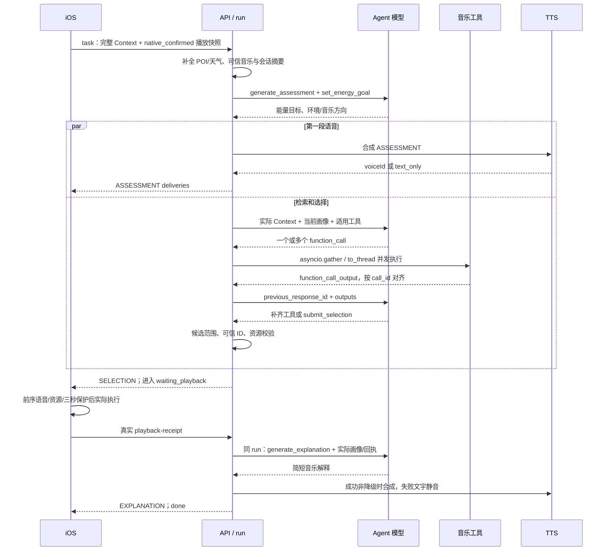

# 工具调用与三阶段 run

## Responses 链路

当前实现把任务、规则、Context 和当前音乐画像构造成 JSON `input`，不是从一份单独的 system.txt 读取。`generate_assessment()`、检索/选择的 Responses 链和 `generate_explanation()` 属于同一个业务 run，分别有模型请求。

检索启用 `parallel_tool_calls=True`。服务端从返回内容提取 `function_call`，用 `asyncio.gather()` 执行同一批调用，每个同步检索 wrapper 通过 `asyncio.to_thread()` 运行。输出保存原 `call_id`，随后把 `function_call_output` 和 `previous_response_id` 送回模型。

必须调用所有适用工具再选择。模型只请求一部分时，下一轮只提供尚未调用的工具；当前循环最多处理四轮工具批次。工具返回结构化错误也属于已响应的调用，不能把它描述为检索成功；选择只能使用实际可信候选和预置当前单元。

所有适用工具已调用后，服务器根据本次动作过滤 `permittedPlaybackUnitIds`，把它们写入 `submit_selection` 的枚举。模型最多提交五个有序选择与首选公开理由；服务端再次过滤并校验资源。模型未提交、返回 incomplete 或资源候选无效都有明确降级状态。

## 真值、幂等与解释

`clientSessionId + clientActionSeq + decisionVersion` 约束创建、交付、取消与回执。`sequence` 用于交付游标与去重；旧 session head 的写入不会复活取消/已完成 run。

音乐结果交付后进入 `waiting_playback`。iOS 回执包含实际 `playbackUnitId`、实际服务歌曲 ID、`success`、`changeKind`、`actualPlaybackState` 和必要的混音/失败信息。API 校验歌曲绑定、选中与实际 ID，以及同曲/跨曲/未变化的关系，重复相同回执幂等，不同回执报冲突。

`continue_after_receipt()` 读取实际音乐画像及该选中候选的公开比较理由，恢复同一个 run 的解释。`generate_explanation()` 以实际回执为准，失败或技术降级不合成 TTS；成功的正常保持也不假装听到了变化。最终交付是 `EXPLANATION`，再把 run 标为 `done`。

## 路径与入口

统一前缀 `/agentic-player/api/v2`：

| 方法 / 路径 | 代码入口 |
| --- | --- |
| `POST /auto/fast` | `main.auto_fast`、`fast_selection.fast_choices` |
| `POST /task` | `main.create_task` → `agent.run_task` |
| `GET /runs/{runId}/deliveries` | `main.poll_deliveries`、`store.deliveries_after` |
| `POST /runs/{runId}/playback-receipt` | `main.playback_receipt` → `agent.continue_after_receipt` |
| `POST /runs/{runId}/cancel` | `main.cancel_run` |
| `GET /voice/{voiceId}` | `main.get_voice` |

API 管理逻辑 run，原生音乐与字幕时序由 iOS 执行。服务端保存交付/回执/工具轨迹用于恢复和排查；公开仓库不包含真实运行轨迹。
